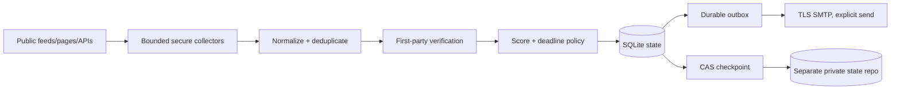

# Scout — autonomous opportunity intelligence

Scout is a bounded, evidence-driven monitoring agent for a student developer and
aspiring founder in Kerala, India. It collects public RSS/Atom, selected HTML,
calendar, GitHub and public API sources; extracts actionable opportunities; checks
important claims against original pages; ranks results; remembers history; and
queues plain-text plus HTML email. It is deterministic by default and requires no
LLM/search API or paid runtime.

Scout is not universal web search, a scraper that bypasses controls, or an
unconstrained AI loop. It will say **unknown** when price, eligibility, dates or
availability are not evidenced. It never treats a free trial as permanent free
access, training as certification, a 200 response as truth, or an event start as a
registration deadline.

Research date: **2026-10-19 Asia/Kolkata**. Research and architecture evidence:

* [`docs/research/automation-landscape.md`](docs/research/automation-landscape.md)
* [`docs/research/architecture-decision-record.md`](docs/research/architecture-decision-record.md)
* [`docs/research/source-discovery-strategy.md`](docs/research/source-discovery-strategy.md)

## What is implemented

* Pydantic opportunity/source/claim/notification contracts with UTC timestamps.
* Safe HTTPX transport: HTTPS/HTTP only, no credentials/non-web ports, public DNS
  pinning at connection time, redirect validation, no environment proxies, response
  and decompression limits, per-host pacing, robots fail-closed, conditional GET,
  403/429 backoff and no automatic rate-limit hammering.
* RSS/Atom, explicit-selector HTML, JSON-LD, generic APIs, CTFtime, GitHub JSON and
  iCalendar collectors. Feed parsers receive bytes only; scraped content cannot
  execute commands, configure Scout, or become a Jinja template.
* Fair due-aware source planner, probation/quarantine registry, trusted-domain
  onboarding, bounded organizer/feed expansion, optional bounded GitHub repository
  search, and source-health/failure history.
* Deterministic extraction and verification: typed timezone-aware dates, explicit
  deadline types, per-claim excerpts, exact publisher-host authority, first-party
  page refresh, conservative deduplication, meaningful update detection, feedback,
  relevance scoring and urgent windows (24/6/1 hours).
* SQLite with process locking, schema migration, checksums, atomic backup/restore,
  corruption refusal, retention/tombstones and a durable notification outbox.
* Private GitHub Contents API checkpoint adapter with a `scout-state` branch in a
  separate private state repository, compressed validated JSON, optimistic blob-SHA
  compare-and-swap and no artifact/cache persistence. It refuses public repositories,
  a state repository equal to the workflow repository, and missing state unless
  bootstrap is explicit.
* TLS-only SMTP sender with safe headers, bounded retry/uncertain-accept handling,
  idempotency keys, stable Message-ID, plain-text alternatives, dry-run and test email.
* GitHub Actions schedule, manual dispatch, concurrency protection, five-minute job
  timeout, locked dependencies, automatic private-state checkpointing and weekly
  health capability through explicit `maintain`. The default schedule is eight
  scan cycles/day at minute 37 of every third hour; the 09:07 IST cycle also queues
  the daily digest. Schedules are best-effort: GitHub can delay/drop them.

## Project layout

```text
scout/                 Python application and CLI
  models.py            strict persisted contracts
  http.py              SSRF-aware bounded transport
  collectors/          RSS, HTML, API, GitHub and calendar parsing
  discovery/           planning, queries and source onboarding
  intelligence/        extraction, verification, scoring, deadlines, dedup
  storage/             SQLite and private GitHub state checkpoint
  notifications/       Jinja templates, SMTP and outbox
  orchestrator.py      bounded scan/digest/verify/maintenance flow
config/                taxonomy, preferences, scoring and source registry
docs/                  research, security, privacy, deployment and operations
tests/                 offline unit/integration/security tests
.github/workflows/     unattended schedule and manual run
demo/fixtures/         clearly labeled synthetic offline demonstration data
```

## Architecture at a glance



The source/workflow repository can be public. Real history, feedback, notification
records and checkpoints must stay in the separately configured private state
repository. See [`docs/buildathon-submission.md`](docs/buildathon-submission.md) for
the release checklist and recording plan.

## Feature and evidence status

| Capability | Status | Evidence boundary |
|---|---|---|
| Secure RSS/Atom, HTML, API, calendar and GitHub-compatible collection | Tested locally | Parser/security fixtures; live source coverage is bounded and partial. |
| First-party claim verification, conservative pricing/eligibility | Tested locally; bounded live smoke | Evidence is claim-specific; unknown remains unknown. |
| Deduplication, material updates, deadline windows and feedback | Tested locally | Offline lifecycle and functional tests. |
| SQLite state, corruption refusal, backup/import and outbox retries | Tested locally | Storage/checkpoint/outbox tests. |
| Separate private GitHub checkpoint repository | Tested against mocks | Requires a private repository and narrowly scoped token. |
| GitHub Actions schedule | Workflow syntax reviewed | Requires a public source repo, private state repo and Actions secrets; scheduled execution not live verified. |
| Real SMTP delivery | Mocked only | Requires owner-configured provider credentials and a deliberate test; receipt not verified. |
| Offline demo | Tested locally | Synthetic `DEMO DATA` fixtures; no real email or production state. |
| Docker rebuild | Not verified on this host | Docker is unavailable locally; exact judge commands are documented. |

## License

Scout is released under the MIT License; see [`LICENSE`](LICENSE). Confirm the
copyright-holder wording before publishing a public repository.

## Local setup

Prerequisites: Python 3.12.13 (or the pinned uv-managed interpreter), `uv`
0.11.28, and Git. Docker is optional. No global Python package installation is
needed. Python 3.12.13 is pinned in [`.python-version`](.python-version); all
dependency versions and hashes are in [`uv.lock`](uv.lock).

```bash
uv sync --frozen
uv run python -m scout.cli --no-email sources health
uv run python -m scout.cli --no-email scan --dry-run --no-discovery
```

On Windows PowerShell, the equivalent direct interpreter is:

```powershell
.venv\Scripts\python.exe -m scout.cli --no-email scan --dry-run --no-discovery
```

## Offline demonstration (2-3 minutes)

The reproducible demo uses only the synthetic, clearly labeled fixtures in
[`demo/fixtures`](demo/fixtures). It creates a temporary SQLite database, never
opens the default `data/` state, never creates an SMTP sender, and removes its
temporary state when it exits.

From the project root:

```bash
uv sync --frozen
uv run python scripts/demo.py
# equivalent Make target:
make demo
```

In PowerShell, use the same `uv run` command (or `make demo` in a Unix-like shell).
The two-to-three-minute walkthrough is visible in the command output:

1. **Collect -> Normalize -> Verify -> Score -> Store -> Alert** loads four
   official synthetic publisher/page fixtures across hackathons, cybersecurity,
   startups and learning, plus one clearly labeled low-quality community claim.
2. The initial report shows evidence counts, ranking, verified-free pricing,
   conditional pricing/eligibility, and unknown pricing/eligibility. It also prints
   the exact 24-, 6- and 1-hour deadline-window decisions and a simulated email
   preview with `SMTP calls: 0`.
3. The repeat phase collects the same fixtures again and reports zero new records,
   zero updates, and no duplicate notifications.
4. The final phase switches only the learning page to `learning-v2.html`, reports a
   material update/version bump, and previews the resulting update notification.

The demo is intentionally separate from production scans. To inspect or change the
synthetic scenario, edit the files under `demo/fixtures` and rerun the command.

Cloud mode requires all three independent state settings in the process environment:
`SCOUT_STATE_REPOSITORY`, `SCOUT_STATE_TOKEN` and `SCOUT_STATE_BRANCH`. The state
repository must be private and must differ from `GITHUB_REPOSITORY` when that public
workflow identity is present. Cloud mode never falls back to `GITHUB_REPOSITORY` or
`GITHUB_TOKEN`; use [`.env.example`](.env.example) for the local variable names.

The visible `data/` directory is local private state and is ignored by Git. If
existing state is missing or corrupt, Scout fails instead of treating the entire web
as new. The first cloud bootstrap is deliberate and baseline-only: existing
discoveries do not flood the inbox.

## CLI

Global options (`--state-dir`, `--config-dir`, `--cloud-state`,
`--bootstrap-cloud-state`, `--no-email`) go before the command. The bootstrap flag
is required only for the deliberate first cloud deployment; normal cloud commands
fail closed if the remote checkpoint is missing.

```bash
uv run python -m scout.cli --no-email scan --dry-run
uv run python -m scout.cli --no-email scan --dry-run --urgent-only
uv run python -m scout.cli --no-email scan --dry-run --category cybersecurity
uv run python -m scout.cli --no-email digest --dry-run
uv run python -m scout.cli --no-email verify --dry-run
uv run python -m scout.cli sources
uv run python -m scout.cli sources health
uv run python -m scout.cli sources discover
uv run python -m scout.cli health
uv run python -m scout.cli state export data/scout-export.json
uv run python -m scout.cli state import data/scout-export.json --replace
uv run python -m scout.cli --no-email test-email --dry-run
uv run python -m scout.cli feedback --id OPPORTUNITY_ID --action save
uv run python -m scout.cli report --limit 25
uv run python -m scout.cli maintain
```

`scan --dry-run` still collects and persists the scan so repeat scans can be tested;
it only prevents SMTP delivery. `test-email` without `--dry-run` is the deliberate
real-send command. It is not run automatically during setup.

## Preferences and sources

Edit [`config/preferences.yaml`](config/preferences.yaml),
[`config/scoring.yaml`](config/scoring.yaml) and [`config/categories.yaml`](config/categories.yaml).
Add sources to [`config/sources.yaml`](config/sources.yaml), keeping a source
disabled/probation until its URL and collector are real. `enabled: true` means Scout
may poll it; it does not confer official verification. The initial registry contains
verified-at-research-time RSS/API/page targets plus quarantined discovery targets.
Run `sources health` after live validation. Source registry changes are included in
the next digest when state is configured.

Coverage is strongest for configured publisher feeds and explicit page structures,
probabilistic for linked organizer pages and public directory entries, and absent
for private/login/CAPTCHA/social/JS-only pages unless a compliant public adapter is
added. Read [`docs/sources.md`](docs/sources.md) before adding a high-volume source.

## Email setup

Copy [`.env.example`](.env.example) to `.env` locally and fill values outside chat:

```bash
cp .env.example .env
# then edit .env in a local secret manager/editor
```

Required only for real delivery: `EMAIL_ENABLED=true`, `SMTP_HOST`, `SMTP_PORT`,
`SMTP_SECURITY` (`starttls` or `ssl`), `SMTP_USERNAME`, `SMTP_PASSWORD`,
`EMAIL_FROM`, `EMAIL_TO`. `TIMEZONE` defaults to `Asia/Kolkata`. Use a provider's
app password/OAuth-approved SMTP route, not a normal account password. For Gmail,
Google documents that app passwords require 2-Step Verification and can be
unavailable for some organization/Advanced Protection accounts. Never commit `.env`.

```bash
uv run python -m scout.cli test-email --dry-run
uv run python -m scout.cli test-email
```

The sender is one recipient, TLS-only, timeout-bounded and capped by the daily
outbox budget. SMTP cannot guarantee exactly-once delivery; a connection loss after
acceptance can produce an eventual duplicate. Scout records that uncertainty and
waits at least 30 minutes before retrying.

## Unattended GitHub Actions deployment

1. Push this project to a public source/workflow repository and create a separate
   **private** state repository with a default branch. The state repository is where
   the checkpoint branch and its history live; never use the public repository for it.
2. Enable Actions. The workflow has `contents: read` only, so its built-in workflow
   token can check out the source but cannot write source or state data.
3. Create a fine-grained token (or an equivalent GitHub App token) scoped only to the
   private state repository with Contents read/write access. Add these repository
   Actions secrets under **Settings → Secrets and variables → Actions**:
   `SCOUT_STATE_REPOSITORY`, `SCOUT_STATE_TOKEN`, `SCOUT_STATE_BRANCH`,
   `EMAIL_ENABLED`, `SMTP_HOST`, `SMTP_PORT`, `SMTP_SECURITY`, `SMTP_USERNAME`,
   `SMTP_PASSWORD`, `EMAIL_FROM`, and `EMAIL_TO`. Set `SCOUT_STATE_BRANCH` to
   `scout-state`. Do not use or add `GITHUB_TOKEN` as the state credential. Set
   `EMAIL_ENABLED=false` first if you want a state-only rollout.
4. For the first deployment only, run **Actions → Scout opportunity intelligence →
   Run workflow** with `scan`, `dry_run=true` and `bootstrap_state=true`. This
   explicitly creates the private state branch and baselines without SMTP. Leave
   `bootstrap_state=false` for every later run; a missing checkpoint then fails
   closed instead of silently creating new state. Inspect the job summary and
   `sources health` locally if needed.
5. Run `test-email` from a local authorized environment or dispatch a deliberate
   real `digest`/`scan` only after reviewing SMTP configuration. The first scheduled
   digest is around 9 AM IST (03:37 UTC), subject to scheduler delay.
6. Keep repository activity or manually re-enable the workflow if GitHub disables a
   public schedule after inactivity. Scheduling is not an exact-time guarantee. Run
   the manual `maintain` mode when you want the weekly health notification; check
   Actions history and the outbox health report.

GitHub Free currently documents 2,000 private-repository hosted-runner minutes/month
and 500 MB artifact storage. The default schedule is 240 scheduled runs in a 30-day
month (248 in a 31-day month), with a five-minute upper job timeout; actual
dependency/install/network time counts. Keep
the repository's Actions budget at zero/blocked if no paid overage is authorized.
Never add larger runners, a payment method or automatic paid fallback. See the ADR
for why Cloudflare, Apps Script, n8n, Activepieces, Huginn, Pipedream and free
hosting alternatives were not selected.

## Docker

The Dockerfile installs the pinned runtime and locked dependencies, includes the
offline tests/demo, and runs a dry, no-email scan by default. Docker is optional for
local development, but this is the judge-style rebuild path:

```bash
docker build -t scout:local .
docker run --rm --network none scout:local /opt/scout/.venv/bin/python scripts/test.py
docker run --rm --network none scout:local /opt/scout/.venv/bin/python scripts/demo.py
```

For durable local state, prefer a named volume so the image's non-root `scout` user
can write safely:

```bash
docker volume create scout-data
docker run --rm -v scout-data:/opt/scout/data scout:local
```

For real email, pass environment values through a platform secret mechanism, for
example `--env-file .env`; `.env` is excluded from the Docker build context and must
never be baked into the image. Docker local execution is reproducible, but it is not
a free unattended host by itself. A Docker build has not been run in this workspace
because Docker is unavailable here; the commands above are the exact intended checks.

## Tests and quality gates

The single offline test command is:

```bash
python scripts/test.py
# or: make test
```

Other checks:

```bash
uv run ruff check scout tests scripts
uv run python -c "from scout.config import Configuration; print(len(Configuration().sources))"
uv run pip-audit                 # online advisory database; optional
```

The test suite uses controlled transports and fixtures, never a real email account,
paid model, or required live site. It covers SSRF/redirect/DNS rebinding, response
limits, feed/HTML/API/calendar parsing, dates/timezones, pricing and eligibility,
verification, scoring, dedup/update/change alerts, state migration/corruption/
backup/import, CAS checkpoint conflicts, outbox idempotency/retries, HTML escaping,
partial failures and source isolation. A live smoke is opt-in and must be reported
separately from the offline suite.

## Security, privacy and operations

Read [`docs/security.md`](docs/security.md), [`docs/privacy.md`](docs/privacy.md),
[`docs/deployment.md`](docs/deployment.md), and [`docs/troubleshooting.md`](docs/troubleshooting.md).
External pages are untrusted data and can contain prompt injection; Scout does not
give them tools. Private preferences, feedback, claim scores, state and email
addresses stay in local ignored state or the separate private state-repository branch. No dashboard
or public artifact is shipped. Restore from a validated export/backup only after
reviewing its source and use `--replace` explicitly.

## Known limitations and remaining manual actions

* No external deployment has been executed from this workspace: GitHub CLI is not
  installed and no repository/SMTP authorization was provided. The exact remaining
  action is to create the public source repository and separate private state
  repository, configure the state/email secrets, enable Actions, and run the dry
  dispatch described above.
* Scheduled Actions may be delayed or dropped; urgent windows are best effort, not
  a one-hour SLA. Short promotions between scans can be missed.
* External SMTP acceptance is not proven by unit tests and exactly-once mail is
  impossible to promise. Sender verification/deliverability are provider concerns.
* JavaScript/login/CAPTCHA/private pages and universal search remain outside default
  coverage. A quarantined URL is not an opportunity or official evidence.
* Cloud checkpoint uses GitHub Contents API and private branch history in the separate
  state repository; if a project policy forbids branch state, migrate the validated
  export to a persistent hosted worker. Do not publish the state repository/branch or
  move it to Pages/artifacts.
* Zero cost is a default design, not a provider guarantee. GitHub, SMTP, source API,
  feed terms, quotas and pricing can change; the operational report surfaces partial
  coverage rather than switching to paid services.
