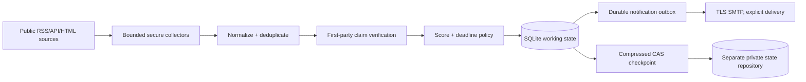

# Frontier Buildathon submission package

Status: **prepared locally; not submitted**

This document is deliberately conservative. Empty fields are not claims of
completion. Fill them only after the owner verifies the external account or performs
the action.

## Project

- **Name:** Scout — Personal Opportunity Intelligence
- **Pitch:** A bounded, evidence-driven agent that finds public opportunities for a
  student developer, verifies important claims, ranks them, remembers changes and
  queues actionable alerts without requiring a paid model or search API.
- **Target user:** A student developer/founder in Kerala, India.
- **Track:** Agents & Automation (intended; confirm in the dashboard).
- **Source repository URL:** **NOT VERIFIED — no GitHub remote or destination is
  configured in this workspace.**
- **Live demo URL:** None; Scout is a CLI/worker and the offline demo is local.
- **Demo video URL:** Not recorded.
- **Buildathon submission ID:** Not available.
- **Unstop submission status:** Not verified.

### Verified OmniRush session

- **Workspace:** `Automation` (`ws_56da7924b8eb`)
- **Session:** `Building Scout: Autonomous Opportunity Agent`
  (`ses_eaf72d393ffeRLvybkw5zMn2PX`)
- **Session evidence:** This current session contains the Scout implementation,
  commits and release work. Dashboard selection/attachment of the session to a
  submission is not verified while OmniRush auth is signed out.

## What the repository demonstrates

The public release should contain application code, tests, synthetic demo fixtures,
research, configuration templates, a Dockerfile, a lockfile and no personal state.
The recommended judge path is:

```bash
uv sync --frozen
uv run python scripts/demo.py
python scripts/test.py
uv run ruff check scout tests scripts
```

The demo is marked `DEMO DATA` and uses a temporary database. It shows collection,
normalization, first-party verification, scoring, deadline windows, repeat-scan
deduplication, a material update and a simulated outbox preview without SMTP.

## Architecture



The source/workflow repository may be public. Real opportunity history, feedback,
notification history and checkpoint data belong only in the separate private state
repository. Cloud mode requires `SCOUT_STATE_REPOSITORY`, `SCOUT_STATE_TOKEN` and
`SCOUT_STATE_BRANCH`, and rejects using the public workflow repository as the state
destination.

## Buildathon checklist

| Requirement | Status | Evidence / owner action |
|---|---|---|
| Join before 19 Oct 2026 23:59 IST | **NOT VERIFIED** | OmniRush auth is signed out. Owner must sign in to the dashboard and confirm Join. |
| Connected GitHub account is participant's account | **NOT VERIFIED** | Confirm in the dashboard; do not submit a repository from another account. |
| Connected GitHub account is at least three days old | **NOT VERIFIED** | Confirm from the connected account. |
| OmniRush is the only generative AI tool used | **UNCERTAIN / DISCLOSE** | The current project work is represented in this OmniRush session, but any external project-planning, architecture, code, text or image assistance cannot be inferred away. If any other generative AI contributed project-specific material, disclose it to the organizer and do not claim sole-tool compliance without clarification. |
| Solo entry | **OWNER CONFIRMATION** | Confirm no teammate is submitting the same project. |
| Public GitHub source repository | **BLOCKED** | Create/publish only after the state-separation and secret gates pass. |
| README and setup/test instructions | **PASS locally** | `README.md`, `.env.example`, `uv.lock`, `.python-version`, Dockerfile and `scripts/test.py` are present. |
| Open-source license | **DRAFT PRESENT** | `LICENSE` is MIT; owner should confirm the copyright-holder wording before public push. |
| Docker rebuild | **BLOCKED locally** | Docker is unavailable on this host; `.github/workflows/reproducibility.yml` is prepared to build the pinned image and run the offline test/demo after the public push. |
| Offline tests | **PASS locally** | `python scripts/test.py` — 110 passed after the current sprint's edits. |
| Demo video | **NOT DONE** | Record a 2–3 minute screen capture using the walkthrough below. |
| Live demo | **OPTIONAL / NOT PROVIDED** | CLI projects do not require a hosted web demo. |
| Submission ID in dashboard | **NOT VERIFIED** | Enter repo, track, sessions and demo links in the dashboard, then record the returned ID. |
| Submission ID entered on Unstop | **NOT VERIFIED** | Paste the confirmed ID into the matching Unstop event entry. |

## Two-to-three-minute recording plan

1. **0:00–0:20 — Problem:** explain that opportunity announcements are scattered,
   deadlines change and unverified “free” claims are easy to miss.
2. **0:20–0:45 — Run:** from a clean checkout run `uv run python scripts/demo.py` and
   point out the `DEMO DATA ONLY` banner and temporary state.
3. **0:45–1:20 — Evidence:** show the four categories, verified-free versus
   conditional versus unknown values, evidence counts and ranked report.
4. **1:20–1:45 — Alerts:** show exact 24/6/1-hour deadline decisions and the
   simulated preview with `SMTP calls: 0`.
5. **1:45–2:05 — Memory:** show the repeat phase with zero new records and no
   duplicate notifications, then the learning-page material update/version bump.
6. **2:05–2:30 — Trust and rebuild:** show `python scripts/test.py`, the Mermaid
   architecture, the separate private state configuration and the honest note that
   real SMTP/GitHub/Docker integrations need owner credentials or a Docker host.

## Owner actions in priority order

1. **Before publication:** sign in to OmniRush, verify Join/eligibility and select
   Agents & Automation; ask the organizer about any uncertainty.
2. Create a public source repository on the connected GitHub account and push only
   the sanitized source branch. Do not push a state branch, database, export or
   credential.
3. Confirm the MIT copyright-holder wording in `LICENSE`; amend it before the public
   push if needed.
4. Create a separate private state repository, issue a narrowly scoped contents
   read/write credential, and configure the `SCOUT_STATE_*` Actions secrets.
5. Run a deliberate dry bootstrap, then a real SMTP test only after reviewing the
   sender configuration; record the actual workflow and receipt evidence.
6. Record the demo, submit the dashboard entry before **20 Oct 2026 23:59 IST**, copy
   the actual Submission ID to Unstop, and verify the final status.

## Manual public publication steps

No remote or GitHub CLI is available in the current workspace, so no push was
attempted. After signing in to the connected GitHub account, use an empty **public**
repository and keep the private state repository separate:

```bash
# Run from the clean Scout checkout after reviewing the connected account/repo name.
git status --short
git remote add origin https://github.com/<CONNECTED_ACCOUNT>/<PUBLIC_REPO>.git
git push -u origin main
git ls-remote origin refs/heads/main
```

Do not create the public repository with an extra README, license or `.gitignore`; the
local release already contains those files. Before pushing, confirm the destination
has no prior `scout-state` branch or private checkpoint history. After the push,
verify the public repository URL, default branch, latest SHA and workflow files in the
browser. Then create/configure a different private state repository and add only the
`SCOUT_STATE_*` and email secrets to the public repository's Actions settings. Do not
put a state token in the source tree or paste it into chat.

If using GitHub CLI on a machine where it is installed, authenticate with `gh auth
login`, create the public repository with the connected account, add the returned
remote and push; verify with `gh repo view` and the GitHub Actions run page. The
current workspace cannot run those commands because `gh` is not installed.
